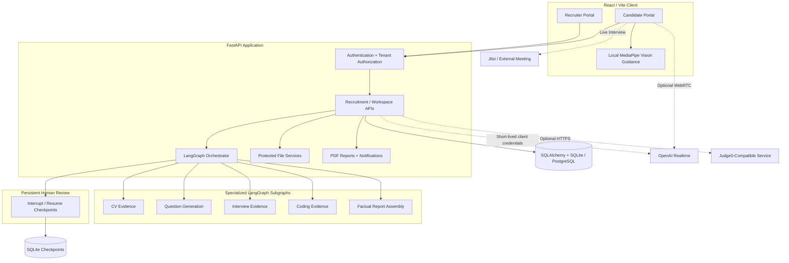

# 🎯 InterviewLoop AI — Enterprise Recruitment Intelligence Platform

<p align="center">
  
  
  
  
  
  
  
  
  
</p>

<p align="center"><strong>Recruit intelligently. Review transparently. Decide with humans.</strong></p>

<p align="center">
  <a href="#-overview">Overview</a> ·
  <a href="#-features">Features</a> ·
  <a href="#-ai--computer-vision">AI & Vision</a> ·
  <a href="#-system-architecture">Architecture</a> ·
  <a href="#-installation">Installation</a> ·
  <a href="#-api-reference">API</a> ·
  <a href="#-security-privacy--responsible-ai">Security</a>
</p>

**InterviewLoop AI** is a local-first, full-stack recruitment workspace connecting **recruiters, candidates, AI-assisted evidence review, human approval checkpoints, video interviews, coding assessments, and offer decisions** in a modern dark glassmorphism interface.

> [!IMPORTANT]
> InterviewLoop AI is an **advanced engineering reference application**, not a certified production ATS or autonomous hiring tool. AI outputs support review; they do not make hiring decisions. Use synthetic data in public demos and complete appropriate security, accessibility, and legal reviews before onboarding real candidates.

---

## 📌 Overview

**InterviewLoop AI** is a full-stack recruitment workflow reference application designed to connect the people, documents, interviews, technical evaluations, and decisions involved in hiring.

Recruiters can publish openings, review application evidence, coordinate technical assessments, conduct live interviews, and record decisions. Candidates can discover published jobs, apply with a CV, complete structured interviews and coding tasks, view scheduling updates, and respond to offers.

Instead of letting an AI model make employment decisions, InterviewLoop uses **LangGraph-backed human-in-the-loop workflows**: the system assembles evidence and pauses at defined checkpoints until an authorized recruiter reviews it and records a rationale.

> **Project status:** This repository is a working, local-first **advanced reference application and engineering portfolio project**, not a certified production applicant-tracking system. Core workflows have been exercised with synthetic local test data. External providers, cross-device behavior, security controls, and deployment readiness require further validation before handling real candidates.

### 🎯 Engineering Goals

- **Evidence over opaque scores:** Make source excerpts, transcripts, test outputs, and reviewer notes inspectable.
- **Human decisions stay human:** No AI auto-hiring or auto-rejection.
- **Consent and visibility:** Camera recording, optional AI processing, and local visual guidance are distinguishable choices.
- **Modular orchestration:** Separate specialized LangGraph subgraphs from state transitions and human approval gates.
- **Practical developer experience:** Run locally on Windows or macOS without containers.

---

## ✨ Features

### 🧑‍💼 Recruiter Workspace

| Module | Capabilities |
| --- | --- |
| **Recruiter dashboard** | Application summaries, active positions, review queue, and workspace activity. |
| **Job management** | Create drafts, define requirements, publish openings, and configure technical assessments. |
| **Applicant Tracking System (ATS)** | Kanban-style pipeline with controlled stage transitions through authorized review actions. |
| **CV evidence review** | Extract supported text from PDF/DOCX resumes and compare documented evidence with job requirements. |
| **AI interview review** | Inspect submitted recordings, candidate transcripts, evidence reports, and follow-up topics. |
| **Coding challenges** | Define problems and test cases, inspect source submissions, and optionally review remote execution results. |
| **Human interviews** | Schedule interviews, generate calendar invitations, use Jitsi or a configured meeting link, and save structured notes. |
| **Final decisions** | Record evidence-based human rationale, extend or decline offers, and track candidate responses. |
| **Organizations & collaboration** | Company workspaces, recruiter invitation codes, workspace switching, and team notes. |
| **Reports & analytics** | Funnel insights, activity records, notifications, audit logs, and downloadable PDF evidence reports. |

### 👩‍💻 Candidate Experience

| Module | Capabilities |
| --- | --- |
| **Candidate dashboard** | Browse published positions and follow personal application progress. |
| **Apply with a CV** | Upload PDF/DOCX documents and manage external AI processing consent. |
| **Structured video interview** | Read generated questions, record responses through the browser, and submit transcripts. |
| **Optional AI voice interviewer** | Connect to an OpenAI Realtime-powered spoken interview session when the provider is configured and consent is given. |
| **Private vision guidance** | Optional on-device face/iris landmark monitoring with a gentle camera-facing reminder. |
| **Coding studio** | Solve assigned challenges using an embedded Monaco editor and submit source code. |
| **Individual interview** | Review scheduling details, obtain a calendar invite, and join an external live meeting. |
| **Offers & notifications** | Receive in-app updates and accept or decline a recorded offer. |
| **Privacy center** | Access supported application-data export and deletion controls. |

### 🔄 End-to-End Recruitment Journey

```text
JOB POSTED
    |
    v
CANDIDATE APPLICATION + CV
    |
    v
CV EVIDENCE ANALYSIS
    |
    v
HUMAN CHECKPOINT #1 — CV REVIEW
    |
    v
STRUCTURED AI-ASSISTED VIDEO INTERVIEW
    |
    v
HUMAN CHECKPOINT #2 — INTERVIEW REVIEW
    |
    +-------> OPTIONAL CODING ASSESSMENT
    |                    |
    |                    v
    |          HUMAN CHECKPOINT #3 — CODE REVIEW
    |                    |
    +<-------------------+
    |
    v
INDIVIDUAL HUMAN INTERVIEW
    |
    v
FINAL RECRUITER DECISION
    |
    v
OFFER EXTENDED / DECLINED
    |
    v
CANDIDATE OFFER RESPONSE (IF OFFERED)
```

Recruiters can stop or decline an application at authorized review stages; this illustration shows the forward path for an approved application. The coding stage is optional and depends on the job configuration.

---

## 🤖 AI & Computer Vision

### 📄 1 / AI-Supported CV Evidence Review

CV analysis extracts text and maps **documented evidence** to explicit job requirements. Results can include evidence snippets, missing or unverified information, and questions for a reviewer to investigate.

- Supported resume formats: **text-based PDF and DOCX**.
- OpenAI analysis is used only when configured and permitted by the candidate.
- A conservative rules-based fallback remains available if the external AI service is unavailable.
- The reviewer can inspect the source CV and must make the stage decision manually.
- Scanned-image PDFs may need additional OCR infrastructure.

**Important:** A skills mention is not independent proof of competence. Reports are supporting evidence, not hiring recommendations or automated rankings.

### 🎙️ 2 / Structured AI Video & Voice Interviews

The candidate studio provides a set of job-relevant interview questions, browser-based recording, protected uploads, recorded-response review, and transcripts. Interview evidence can be assembled into a recruiter-facing report; the recruiter decides whether the application advances.

An optional **OpenAI Realtime WebRTC** experience can deliver spoken interaction and live text events. It requires a working browser microphone, provider access, an OpenAI API key, and explicit candidate participation. The basic recorded-question workflow works without a real-time voice connection.

### 👁️ 3 / Vision Plus 3.1 — On-Device Eye & Face Guidance

The browser-side vision module uses **MediaPipe Face Landmarker** and its facial/iris landmarks to offer approximate camera-facing feedback during an interview.

| Vision capability | Behavior |
| --- | --- |
| Face presence | Indicates whether a face is visible in the local camera frame. |
| Multiple faces | Can flag multiple visible faces as a local camera status event. |
| Iris landmark estimation | Uses geometric landmark positions as one approximate directional signal. |
| 3D head orientation | Uses the optional facial transformation matrix when supported, falling back to available 2D signals. |
| Automatic calibration | Establishes a local reference from stable webcam-facing frames after candidate opt-in. |
| Temporal filtering | Smooths transient measurements to reduce one-frame noise. |
| Gentle reminder | May show a notice after approximately three seconds of sustained deviation; clears when the local reference returns. |
| Candidate control | Monitoring can be declined, paused, or turned off. |

**Privacy and accuracy boundaries:** Vision guidance automatically starts with the interview camera **only after the candidate has explicitly opted into local guidance**. Facial landmarks, inferred direction measurements, and vision reminder events are not transmitted to the backend or recruiter. Separately consented interview recordings are uploaded as part of the video interview workflow.

This is **not eye-contact verification**. MediaPipe cannot reliably determine a person's actual gaze target or intent. Camera position, lighting, glasses, accessibility needs, reading on-screen prompts, and ordinary eye or head movement can produce false alerts. The system does **not** infer emotions, dishonesty, cheating, attention, identity, or employment suitability from vision signals.

### 💻 4 / Technical Coding Assessments

Recruiters can attach a coding challenge to a draft position. Candidates work in the Monaco-based editor and submit code for review.

- Defined prompts and public/hidden test cases.
- Optional remote execution through a **trusted Judge0-compatible HTTPS provider**.
- **No candidate-submitted code is executed inside the FastAPI server process.**
- Without a configured remote executor, source submissions can still be reviewed manually.
- Execution results support human technical evaluation; they do not automatically reject applicants.

---

## 🏗️ System Architecture



### 🧠 LangGraph Subgraphs & Human-in-the-Loop

The source implements **five specialized compiled subgraphs**:

1. **CV evidence subgraph** — organize requirements and document-based observations.
2. **Interview question subgraph** — prepare structured, job-relevant questions.
3. **Video evidence subgraph** — assemble transcript-linked observations for review.
4. **Coding evidence subgraph** — organize factual challenge and submission information.
5. **Report subgraph** — produce an evidence-oriented report outline.

The parent workflows use persistent checkpoints and LangGraph human interrupts (`interrupt()` / `Command(resume=...)`) around **CV review, video review, and coding review**. Authorized recruiter actions resume the relevant workflow. A model-generated output cannot independently issue a final hiring decision.

### 🛠️ Tech Stack

| Layer | Technology |
| --- | --- |
| Frontend | React 19, Vite 6, React Router |
| Visual design | Custom glassmorphism CSS, Framer Motion, Lucide icons |
| Data visualization | Recharts |
| Coding editor | Monaco Editor (`@monaco-editor/react`) |
| Backend | Python, FastAPI, Uvicorn, Pydantic |
| AI orchestration | LangGraph, persistent SQLite checkpointing |
| AI services | OpenAI API; optional Realtime API over WebRTC |
| Computer vision | MediaPipe Tasks Vision / Face Landmarker |
| Persistence | SQLAlchemy, SQLite by default; PostgreSQL driver optional |
| Security foundations | Argon2 password hashing, JWT, tenant-aware authorization |
| Document processing | pypdf, python-docx, ReportLab |
| Live interviews | Jitsi or configured external meeting provider |
| Optional services | Judge0-compatible remote executor, SMTP email |

## 📁 Project Structure

```text
InterviewLoop-AI-Enterprise/
├── backend/
│   ├── app/
│   │   ├── main.py                 # Core API and recruitment routes
│   │   ├── enterprise.py           # Organizations and extended APIs
│   │   ├── models.py               # Database models
│   │   ├── security.py             # Authentication helpers
│   │   └── services/
│   │       ├── ai.py               # CV / interview evidence
│   │       ├── workflows.py        # LangGraph subgraphs + approval gates
│   │       ├── enterprise_ai.py    # Realtime and remote code services
│   │       ├── reporting.py        # PDF generation
│   │       ├── reminders.py        # Interview reminders
│   │       └── files.py            # Protected file access
│   ├── scripts/                    # Seed and smoke-test utilities
│   ├── tests/                      # Backend tests
│   ├── requirements.txt
│   └── .env.example
├── frontend/
│   ├── src/
│   │   ├── pages/                  # Recruiter / candidate workflows
│   │   ├── components/             # Shared UI and voice interface
│   │   └── vision/                 # Local face and gaze-proxy guidance
│   ├── scripts/setup-vision.mjs
│   ├── package.json
│   └── .env.example
├── scripts/                       # Windows + macOS/Linux launchers
├── docs/
│   ├── ARCHITECTURE.md
│   ├── FEATURE-MATRIX.md
│   └── SECURITY.md
├── FEATURES-VISION.md
├── VISION-PLUS-UPDATE.md
└── README.md
```

---

## ⚙️ Installation

> **No Docker, Docker Compose, or container runtime required.** Two terminals are enough for local development.

### Prerequisites

- **Python 3.11+** with `pip` and `venv` available.
- **Node.js 20+** and npm.
- Internet access for the first dependency installation and the MediaPipe model download.
- Chrome or Edge recommended for camera/microphone testing.
- Optional: OpenAI API access for LLM analysis and real-time voice; other providers as needed.

### 1 / Windows — VS Code & PowerShell

Clone the repository (or open your already extracted project folder):

```powershell
git clone https://github.com/sudeeraattanayake/InterviewLoop-AI-Enterprise.git
cd InterviewLoop-AI-Enterprise
```

**Terminal 1 — backend:**

```powershell
Set-ExecutionPolicy -Scope Process -ExecutionPolicy Bypass -Force
.\scripts\start-backend.ps1
```

**Terminal 2 — frontend:** Open a **new terminal in the project root**, then run:

```powershell
Set-ExecutionPolicy -Scope Process -ExecutionPolicy Bypass -Force
.\scripts\start-frontend.ps1
```

The launch scripts install their respective dependencies on first run, create local `.env` files from the examples when missing, and start development servers. The frontend setup also downloads the required local MediaPipe assets.

> PowerShell execution-policy changes above apply to the current process only. Review the scripts before running them; an organization-enforced policy may still block execution.

### 2 / macOS & Linux

**Terminal 1 — backend:**

```bash
./scripts/start-backend.sh
```

**Terminal 2 — frontend:**

```bash
./scripts/start-frontend.sh
```

Run these commands from the project root. On macOS/Linux you may need to mark the scripts executable (`chmod +x scripts/*.sh`).

### 3 / Local Endpoints

| Service | URL |
| --- | --- |
| Frontend application | `http://127.0.0.1:5173` |
| FastAPI backend | `http://127.0.0.1:8000` |
| Interactive API docs | `http://127.0.0.1:8000/docs` |

Keep both terminals running. Stop either process with `Ctrl+C`. Browser camera and microphone access require **localhost or a secure HTTPS origin**.

### 4 / Backend Environment Variables

Edit **`backend/.env`** (not `.env.example`) after the first launch:

```dotenv
SECRET_KEY=REPLACE_WITH_A_LONG_RANDOM_SECRET
OPENAI_API_KEY=your-own-server-side-openai-key
OPENAI_MODEL=gpt-4.1-mini
DATABASE_URL=sqlite:///./data/interviewloop.db
DEMO_MODE=false
```

Generate a secure secret, for example:

```powershell
python -c "import secrets; print(secrets.token_urlsafe(48))"
```

Copy the printed secret into `SECRET_KEY`, then **restart the backend**. Never expose your real API key in GitHub, frontend source code, screenshots, browser devtools, or support requests.

**OpenAI is optional for a local smoke test.** Without a working key and model access, the application can still use local evidence fallback and human-led flows. A valid API key alone does not guarantee that model access, billing, real-time voice, and all AI calls are working.

---

## 🔌 Optional AI & Provider Integrations

| Service | Configuration | What changes |
| --- | --- | --- |
| **OpenAI** | `OPENAI_API_KEY`, `OPENAI_MODEL` | External AI evidence processing, where consented and supported. |
| **OpenAI Realtime** | `REALTIME_MODEL` and a supported account/model | Spoken AI interview over browser WebRTC. |
| **Judge0-compatible execution** | `JUDGE0_URL`, optional provider credentials | Remote, isolated coding test execution. |
| **SMTP** | `ENABLE_EMAIL=true`, `SMTP_HOST`, `SMTP_PORT`, `SMTP_USER`, `SMTP_PASSWORD`, `SMTP_FROM` | Opted-in email reminders. |
| **Reminders** | `ENABLE_REMINDERS=true` | Periodic local-process checks and in-app interview reminders. |
| **PostgreSQL** | Install `backend/requirements-postgres.txt`, set `DATABASE_URL` | Optional database alternative to SQLite. |

**Notes:**

- The local development setup does **not** bundle or require a code-execution server. If no trusted Judge0-compatible endpoint is configured, coding remains a human-review workflow.
- Jitsi meetings depend on an external provider. InterviewLoop is not itself a video conferencing server.
- Realtime voice sessions and email delivery depend on external availability, permissions, and potential usage charges.
- For production-scale workers, replace the single-process reminder loop and local checkpoint/file storage with appropriately managed services.

---

## 🌐 API Reference

The backend exposes interactive FastAPI/OpenAPI documentation at **[`http://127.0.0.1:8000/docs`](http://127.0.0.1:8000/docs)**. The endpoints below are selected examples from the project; access depends on role and application state.

| Method | Endpoint | Purpose |
| --- | --- | --- |
| `GET` | `/api/health` | Basic backend health check |
| `POST` | `/api/auth/register` | Register a recruiter or candidate |
| `POST` | `/api/auth/login` | Authenticate and obtain a session token |
| `GET` | `/api/jobs` | List accessible job openings |
| `POST` | `/api/jobs` | Create a draft job (recruiter) |
| `POST` | `/api/jobs/{jid}/publish` | Publish a job posting |
| `POST` | `/api/jobs/{jid}/apply` | Submit candidate application and CV |
| `GET` | `/api/applications/{aid}` | View an authorized application |
| `POST` | `/api/applications/{aid}/review-cv` | Record recruiter CV decision |
| `POST` | `/api/applications/{aid}/video-complete` | Complete structured video answers |
| `POST` | `/api/applications/{aid}/review-video` | Record recruiter interview review |
| `POST` | `/api/applications/{aid}/coding/submit` | Submit coding assignment |
| `POST` | `/api/applications/{aid}/coding/review` | Record human code-review outcome |
| `POST` | `/api/applications/{aid}/schedule` | Schedule individual interview |
| `GET` | `/api/applications/{aid}/calendar.ics` | Download calendar invitation |
| `GET` | `/api/applications/{aid}/report` | Download evidence PDF |
| `POST` | `/api/applications/{aid}/final-decision` | Record final human decision |
| `POST` | `/api/applications/{aid}/offer-response` | Candidate offer response |
| `GET` | `/api/analytics` | Tenant-scoped recruitment analytics |
| `GET` | `/api/privacy/export` | Export supported candidate data |

> Request and response schemas, authentication rules, and complete route lists are defined by the running server's Swagger UI. Do not assume these are public or unauthenticated APIs.

---

## 🧭 Example Recruitment Workflow

Use **synthetic data and test accounts only** when demonstrating the platform publicly.

1. **Recruiter registration:** Sign up as a recruiter and create a company workspace.
2. **Publish a position:** Create a job, define requirements, optionally add a coding assessment, and publish it.
3. **Candidate application:** Register as a candidate, open the published job, and submit a test CV.
4. **CV evidence:** Inspect requirement-linked evidence and any clearly labeled external-AI or local-fallback status.
5. **First human review:** Recruiter approves the CV step or declines with a written rationale.
6. **Video interview:** Candidate permits recording and completes the structured questions; optional voice AI and separately opted-in camera guidance can be tested.
7. **Interview evaluation:** Recruiter views the protected recordings/transcripts and records the second human checkpoint decision.
8. **Optional code test:** Candidate submits source code; recruiter reviews it, including remote execution evidence if enabled, and records the coding checkpoint.
9. **Individual interview:** Recruiter schedules a meeting, downloads an `.ics` invitation, and joins a configured live meeting with the candidate.
10. **Final human decision:** Recruiter records structured notes, rationale, and a manual offer or decline.
11. **Candidate response:** If offered, the candidate can accept or decline. Recruiter reviews the updated outcome.
12. **Workspace review:** Explore ATS, analytics, reports, notifications, audit events, and candidate privacy controls.

For testing separate roles in one browser, use a **normal window for the recruiter** and an **Incognito/private window for the candidate** to avoid shared login sessions.

### Optional local demo seed

Enable `DEMO_MODE=true` only in a private development environment, restart the backend, then execute:

```powershell
cd backend
.\.venv\Scripts\python.exe -m scripts.seed_demo
```

See `backend/scripts/seed_demo.py` for the local-only sample accounts. Do not enable demonstration users on an internet-facing service.

---

## 🧪 Testing & Verification

After installing dependencies, run the automated checks in separate terminals.

**Backend — Windows PowerShell:**

```powershell
cd backend
.\.venv\Scripts\python.exe -m pytest -q
.\.venv\Scripts\python.exe -m scripts.smoke_test
.\.venv\Scripts\python.exe -m scripts.enterprise_smoke_test
```

**Frontend — Windows PowerShell:**

```powershell
cd frontend
npm run test:vision
npm run build
```

These checks complement, but do not replace, manually validating role authorization, browser camera/mic behavior, external service integration, consent handling, and the complete recruitment workflow.

### Verification status

- **Manually demonstrated locally:** recruiter and candidate portals, job posting, application submission, structured video recording, browser-side vision indicators, recruiter reviews, interview scheduling screens, final offer and candidate acceptance with synthetic data.
- **Source-level checks performed during development:** Python/vision unit tests and a synthetic API smoke check.
- **Still requiring independent validation:** actual OpenAI-based CV analysis in the running application, Realtime voice against a provisioned model, Judge0 execution, complete browser build on every target machine, full live two-party video calling, production security, scale, and legal/privacy compliance.

**A working screen or synthetic demo does not by itself establish production readiness or model accuracy.**

---

## 🔐 Security, Privacy & Responsible AI

InterviewLoop is designed around **explainable evidence and recruiter accountability**, not automated people assessment.

### Built-in Development Foundations

- JWT-based authentication, Argon2 password hashing, and role-aware routes.
- Workspace-scoped application access and human approval endpoints.
- Protected CV/recording access; candidate consent controls and privacy actions.
- Human review rationales, audit records, and workflow checkpoints.
- Local-only computer-vision landmarks and gaze proxies (no gaze telemetry sent to recruiters).
- No in-process execution of untrusted candidate source code.

### Before Handling Real Applicant Data

A real deployment requires independent security and legal review, including:

- HTTPS, hardened session management, CSRF protections as appropriate, MFA/SSO, account recovery, and robust rate limiting.
- Secure secret storage, database migrations and backups, encrypted media/object storage, malware scanning, and retention/deletion policies.
- Privacy notices, candidate consent records, accessibility testing, human oversight documentation, and review of applicable employment and AI laws.
- Provider data-processing terms for OpenAI, meeting services, code runners, and email services.
- Tenant-isolation penetration tests, abuse testing, audit integrity, and staged rollout monitoring.

**Explicitly out of scope:** facial identity recognition, emotion recognition, lie detection, cheating judgments, AI-generated suitability scores, automated candidate ranking, automated rejection, and automated hiring decisions.

For a more complete discussion, see [Security Notes](docs/SECURITY.md) and the [Architecture Guide](docs/ARCHITECTURE.md).

---

## 🚀 Roadmap

The roadmap describes **future work**, not completed features.

- [ ] Benchmark gaze-proxy robustness across cameras, lighting, accessibility scenarios, and device positions.
- [ ] Build a consent-first, calibrated gaze research mode with ground-truth validation (not a hiring signal).
- [ ] Add production-grade identity and session management, MFA/SSO, account verification, and tested migrations.
- [ ] Move recordings and durable workflow state to managed encrypted infrastructure.
- [ ] Add CI checks and test coverage for real provider integrations and cross-browser experiences.
- [ ] Improve transcript quality checks, recruiter evidence provenance, and test-data hygiene.
- [ ] Add accessible user-flow audits, retention administration, and production observability.
- [ ] Complete security, privacy, and regulatory readiness reviews before public onboarding.

---

## 📚 Documentation & References

- [System Architecture](docs/ARCHITECTURE.md)
- [Feature Matrix](docs/FEATURE-MATRIX.md)
- [Security and Operational Limitations](docs/SECURITY.md)
- [Vision Module Details](FEATURES-VISION.md)
- [Vision Plus 3.1 Upgrade Notes](VISION-PLUS-UPDATE.md)


### External Documentation

- [LangGraph — Graphs and human-in-the-loop workflows](https://docs.langchain.com/oss/python/langgraph/overview)
- [FastAPI Documentation](https://fastapi.tiangolo.com/)
- [OpenAI API Documentation](https://platform.openai.com/docs/overview)
- [MediaPipe Face Landmarker](https://ai.google.dev/edge/mediapipe/solutions/vision/face_landmarker)
- [React Documentation](https://react.dev/)
- [Vite](https://vite.dev/)

---

## 👨‍💻 Author

**Sudeera Attanayake** — AI Engineering · Agentic AI · Full-Stack AI Applications

- **GitHub:** [@sudeeraattanayake](https://github.com/sudeeraattanayake)
- **LinkedIn:** [Sudeera Attanayake](https://www.linkedin.com/in/sudeera-attanayake-9631b03b0)
- **Repository:** [InterviewLoop-AI-Enterprise](https://github.com/sudeeraattanayake/InterviewLoop-AI-Enterprise)


## 🤝 Contributing & Feedback

Issues, improvement suggestions, and pull requests are welcome. Before contributing, avoid uploading real applicant records, private recordings, tokens, or model-provider credentials. Security-sensitive disclosures should be shared privately rather than posted as public issues.

---

## 📃 License

No explicit open-source license is included in the current project source. **Do not assume MIT/Apache licensing or unrestricted reuse.** Add a `LICENSE` file if and when you choose the terms under which others may use, modify, or distribute the software.

---

<div align="center">

**🎯 InterviewLoop AI — Intelligent workflows. Verifiable evidence. Human decisions.**

*Built for exploring the engineering of responsible, end-to-end recruitment systems.*

</div>
