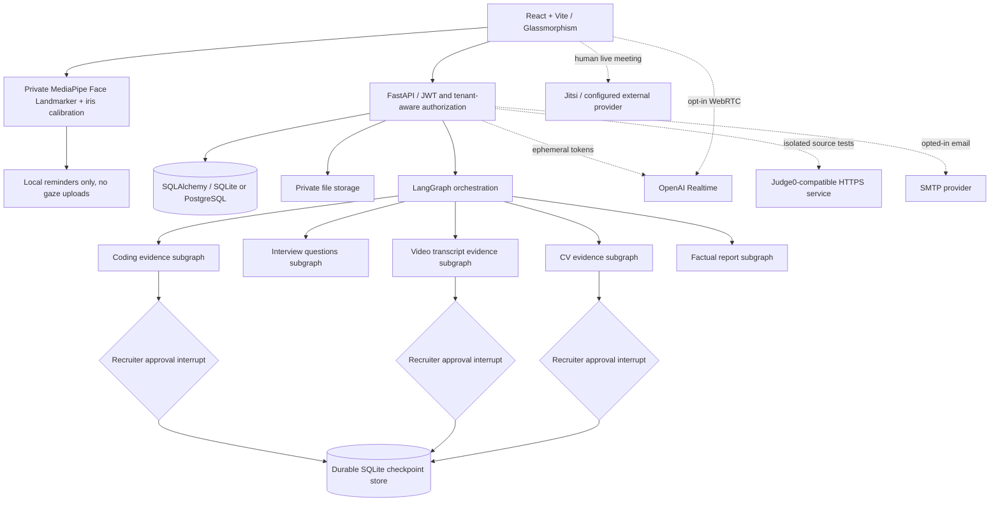

# InterviewLoop AI — architecture and modules

## System boundaries

## Stage transitions

`processing_cv` → `awaiting_cv_review` → **recruiter CV approval** → `video_invited` → `awaiting_video_review` → **recruiter video approval** → optional `coding_invited` → `coding_submitted` → **recruiter code approval** → `individual_pending` → `individual_scheduled` → **human final interview assessment** → `offer_extended` → `hired` or `offer_declined`. Human-initiated declines have separate documented stages. No AI graph writes a hire/reject outcome.

## Code map

- `backend/app/main.py`: existing recruitment workflow, CV upload, authentication, status transitions, audit and health.
- `backend/app/enterprise.py`: additional tenant permissions, challenge/test route, reports, offers, voice token minting, team notes and notifications.
- `backend/app/services/workflows.py`: five real compiled LangGraph subgraphs; parent checkpointed human approval graphs for CV, video, code.
- `backend/app/services/ai.py`: consent-dependent LLM evidence generation with local fallback; conservative excerpts.
- `backend/app/services/enterprise_ai.py`: HTTPS-only remote code test service and OpenAI Realtime ephemeral client secrets.
- `backend/app/services/reminders.py`: recurring database-backed 24h reminder check.
- `backend/app/services/reporting.py`: on-demand PDF generation.
- `frontend/src/pages/`: separate portals, forms, analytics, reports, Kanban, coding, company and human live room.
- `frontend/src/components/VoicePanel.jsx`: browser WebRTC audio event protocol.
- `frontend/src/vision/`: local MediaPipe face landmarks, neutral iris/head calibration, sustained event reports.

## Deployable development architecture

Local laptop runs one FastAPI process plus one Vite dev process. `.env` secrets remain server-side. SQLAlchemy supports PostgreSQL with an optional driver. For real multi-organization production, harden sessions, scope every record, add DPA/retention, scan uploaded files, move file and graph state to durable services, test with concurrent workers, and implement background-job and retry policy. The source deliberately provides **no Docker configuration**.
